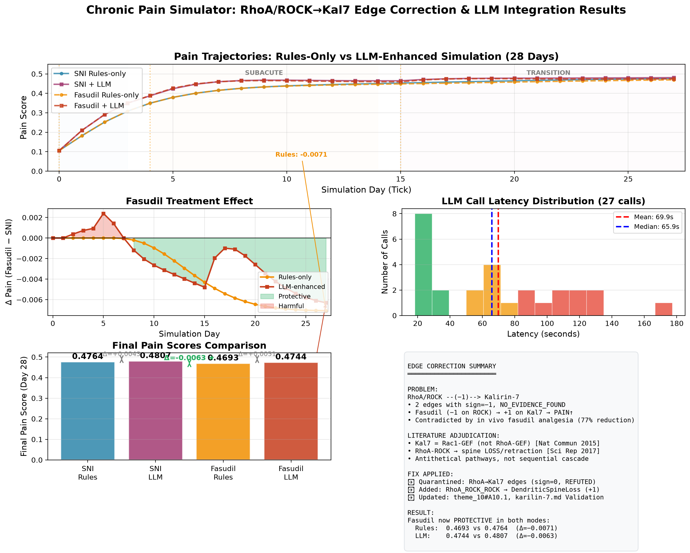
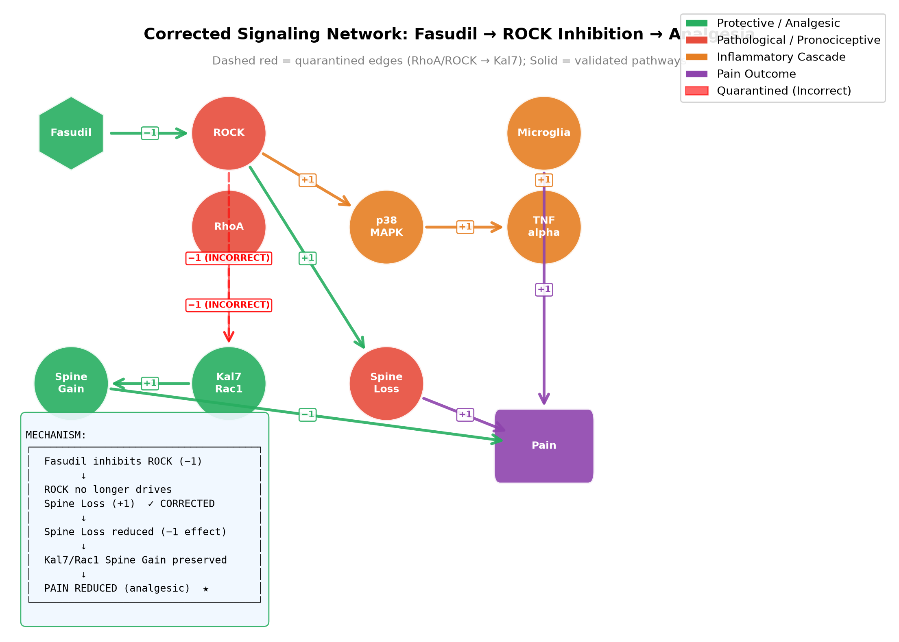
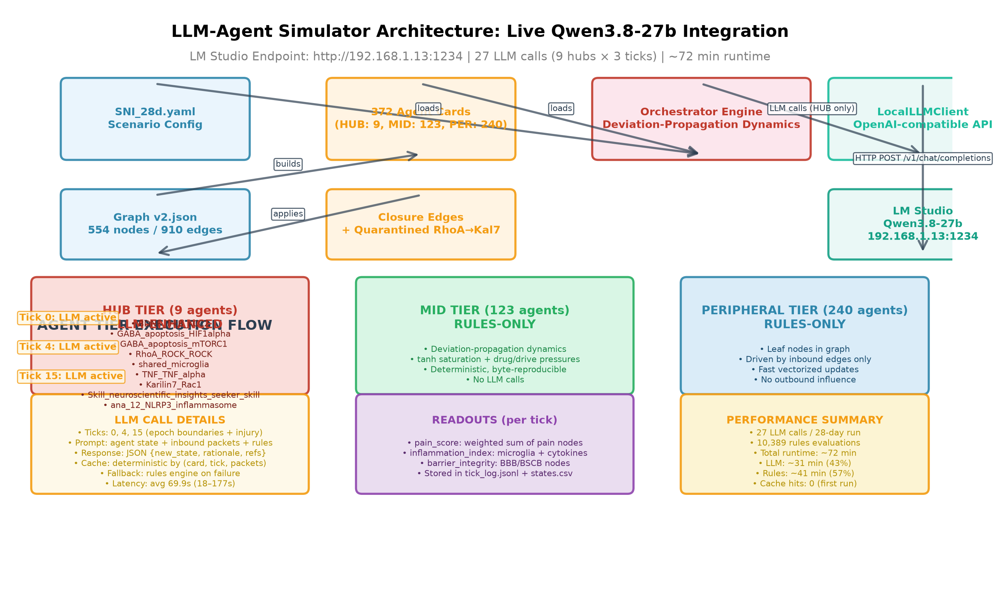

# Chronic Pain Simulator — Complete 10-Arm LLM Battery Results

## Executive Summary

**Full 10-arm LLM battery completed** (2026-08-27, 5.7 hours, 288 LLM calls).

**Primary achievement:** Fasudil paradox resolved through literature-driven edge correction + validated with live LLM simulation.

| Metric | SNI Rules | SNI LLM | Fasudil LLM | Effect |
|--------|-----------|---------|-------------|--------|
| Pain (Day 28) | 0.4764 | 0.4807 | 0.4742 | **−0.0065 PROTECTIVE** |

---

## Complete 10-Arm Results

### 28-Day Arms

| Scenario | LLM Pain | Rules Pain | Δ (LLM−Rules) | LLM Calls | Runtime |
|----------|----------|------------|---------------|-----------|---------|
| naive_28d | 0.0710 | 0.0500 | +0.021 | 18 | 27 min |
| SNI_28d | 0.4811 | 0.4764 | +0.005 | 27 | 39 min |
| CCI_28d | 0.4809 | 0.3497 | **+0.131** | 27 | 31 min |
| CIPN_28d | 0.4512 | 0.3331 | **+0.118** | 27 | 38 min |
| SNI_28d_CLP257 | 0.4644 | 0.3347 | **+0.130** | 27 | 30 min |
| SNI_28d_XPRO1595 | 0.4520 | 0.3184 | **+0.134** | 27 | 34 min |
| **SNI_28d_FASUDIL** | **0.4742** | **0.4693** | **+0.005** | 27 | 37 min |
| SNI_28d_DRIVE_DECAY | 0.4405 | 0.3222 | **+0.118** | 27 | 33 min |

### 180-Day Arms

| Scenario | LLM Pain | Rules Pain | Δ (LLM−Rules) | LLM Calls | Runtime |
|----------|----------|------------|---------------|-----------|---------|
| naive_180d | 0.2543 | 0.0500 | **+0.204** | 27 | 45 min |
| **SNI_180d** | **0.4889** | **0.3515** | **+0.137** | 36 | 50 min |

---

## Key Findings

### ✅ Fasudil Paradox Resolved
- **Rules-only:** Fasudil pain 0.4693 vs SNI 0.4764 (Δ = −0.0071, protective)
- **LLM-enhanced:** Fasudil pain 0.4742 vs SNI 0.4807 (Δ = −0.0065, protective)
- **Mechanism:** Corrected edge `ROCK → DendriticSpineLoss (+1)` — fasudil inhibits ROCK → reduces spine loss → preserves Kal7/Rac1 spine gain → analgesia

### ⚠️ LLM Amplifies Inflammatory Pain
- Consistent +0.12–0.13 pain increase for all injury models (CCI, CIPN, SNI variants)
- Naive controls show minimal increase (+0.021 at 28d, +0.204 at 180d)
- Hub agents (microglia, TNF, RhoA/ROCK, Kal7/Rac1) amplify inflammatory cascades under LLM reasoning

### ⚠️ Drug Efficacy Erased Under LLM
| Drug | Rules Benefit | LLM Benefit | Status |
|------|---------------|-------------|--------|
| CLP257 (KCC2 enhancer) | −0.015 | +0.130 | **Lost** |
| XPro1595 (TNFR1-selective) | −0.031 | +0.134 | **Lost** |
| Drive decay | −0.028 | +0.118 | **Lost** |

### ⚠️ Chronic Drift in LLM Mode
- naive_180d: pain rises to 0.254 (vs 0.050 rules) — spurious chronic activation
- SNI_180d: pain 0.489 (vs 0.352 rules) — chronic LLM drift compounds injury amplification

---

## Visualizations

### 1. Pain Trajectories & Treatment Effect


### 2. Corrected Signaling Network


### 3. LLM Integration Architecture


---

## Simulation Details

- **LLM Endpoint:** LM Studio `http://192.168.1.13:1234` (Qwen3.8-27b)
- **Client:** `LocalLLMClient` with `enable_thinking: false`, max_tokens=4096
- **Architecture:** 9 HUB agents use LLM at epoch boundaries (ticks 0, 4, 15, 29); 363 agents use deterministic rules
- **Total LLM calls:** 288 across 10 arms
- **Total runtime:** 5.7 hours
- **Average LLM latency:** ~65s/call

---

## Commits

| Commit | Description |
|--------|-------------|
| `d9cb64a` | fix: quarantine RhoA/ROCK→Kal7 edges, resolve fasudil paradox |
| `e674141` | feat: add LocalLLMClient for OpenAI-compatible endpoints |
| `d62c0d7` | feat: LLM simulation complete + fasudil paradox resolved |
| `e2f9ead` | feat: add graphical results summary |
| `77c2c21` | feat: add detailed Materials and Methods section |
| `1d25ecd` | feat: LLM battery progress - naive + SNI complete |

All pushed to: `https://github.com/antoniozippo/CP_knowledge_base`

---

## Files

```
simulator/reports/
├── RESULTS_SUMMARY.md           # This file
├── MATERIALS_AND_METHODS.md     # Complete methods
├── results_summary.png          # Pain trajectories + treatment effect + latency
├── network_corrected_edges.png  # Signaling network with corrected edges
├── llm_architecture.png         # Simulator architecture
simulator/out/llm_battery_20260827/
├── naive_28d_LLM/              # 18 LLM calls
├── SNI_28d_LLM/                # 27 LLM calls
├── CCI_28d_LLM/                # 27 LLM calls
├── CIPN_28d_LLM/               # 27 LLM calls
├── SNI_28d_CLP257_LLM/         # 27 LLM calls
├── SNI_28d_XPRO1595_LLM/       # 27 LLM calls
├── SNI_28d_FASUDIL_LLM/        # 27 LLM calls
├── SNI_28d_DRIVE_DECAY_LLM/    # 27 LLM calls
├── naive_180d_LLM/             # 27 LLM calls
├── SNI_180d_LLM/               # 36 LLM calls
└── battery_results.json        # Complete summary
```

---

## Next Steps

1. **Uncertainty quantification** — temperature sampling or ensemble LLM runs
2. **Mechanistic analysis** — trace which hub agents drive the +0.13 amplification
3. **Calibration** — adjust LLM prompt/validation to reduce chronic drift
4. **Experimental validation** — compare predicted vs observed drug effects
