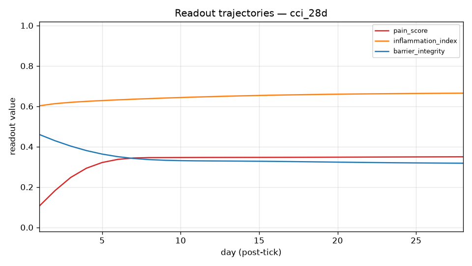

# CP Simulator Experiment Report

## 1. Run Overview

- run_dir: simulator/reports/runs/CCI_28d
- scenario: cci_28d
- injury_model: CCI
- injury_tick: 0
- horizon_days: 28
- seed: 0
- engine_version: 0.1.0
- started_at_utc: 2026-08-26T13:26:40Z
- generated_at: 2026-08-26T13:29:03Z
- llm_calls_made: 0
- llm_calls_deferred: 0
- notes: Chronic constriction injury (Bennett-Xie model): loose ligatures produce ongoing Wallerian degeneration with a strong peripheral inflammatory exudate. Shares the SNI core cascade (microglia, TNF, ROS, TLR4 as DAMP proxy, MMP-9, BDNF, HIF1-alpha) and adds kinin/interleukin peripheral drivers: bradykinin (inflammatory exudate, B1R induction) and IL-6 (autocrine neuronal loop, NKCC1 phosphorylation). Sustained drives model the persistent constriction source: tonic microglial activation, TNF and IL-6 elevation through the whole horizon.

## 2. Readout Trajectories

| day | pain_score | inflammation_index | barrier_integrity |
|---|---|---|---|
| 2 | 0.1822 | 0.6129 | 0.4292 |
| 4 | 0.2931 | 0.6243 | 0.3805 |
| 6 | 0.3368 | 0.6317 | 0.3503 |
| 8 | 0.3457 | 0.6379 | 0.3358 |
| 10 | 0.3461 | 0.6433 | 0.3306 |
| 12 | 0.3465 | 0.6479 | 0.3291 |
| 14 | 0.3467 | 0.6518 | 0.3282 |
| 16 | 0.3469 | 0.6550 | 0.3269 |
| 18 | 0.3473 | 0.6577 | 0.3251 |
| 20 | 0.3478 | 0.6598 | 0.3232 |
| 22 | 0.3483 | 0.6615 | 0.3215 |
| 24 | 0.3488 | 0.6628 | 0.3200 |
| 26 | 0.3493 | 0.6639 | 0.3188 |
| 28 | 0.3497 | 0.6648 | 0.3178 |

## 3. Key Entity Traces

### CSF1-CSF1R_SpinalMicroglia — Spinal Microglia (Activated) (key: microglia)

state ▅▆▆▆▆▆▆▆▆▆▆▆▆▆▆▆▆▆▆▆▆▆▆▆▆▆▆▆
final 0.7725 vs baseline 0.5000 -> delta +0.2725

### GABA_apoptosis_TNF_alpha — TNF-α (Pro-Inflammatory Cytokine) (key: TNF)

state ▅▅▆▆▆▆▆▆▆▆▆▆▆▆▇▇▇▇▇▇▇▇▇▇▇▇▇▇
final 0.8452 vs baseline 0.5000 -> delta +0.3452

### BDNF_TrkB_proBDNF — proBDNF (key: BDNF)

state ▅▅▅▅▅▅▅▅▅▅▅▅▅▅▅▅▅▅▅▅▅▅▅▅▅▅▅▅
final 0.5000 vs baseline 0.5000 -> delta +0.0000

### BBB_CypA_MMP9_pathway — CypA-MMP-9 Pathway (key: MMP-9)

state ▅▅▅▅▅▆▆▆▆▆▆▆▆▆▆▆▆▆▆▆▆▆▆▆▆▆▆▆
final 0.7370 vs baseline 0.5000 -> delta +0.2370

### BDNF_TrkB_CLP257 — CLP257 (KCC2 Enhancer) (key: KCC2)

state ▁▁▁▁▁▁▁▁▁▁▁▁▁▁▁▁▁▁▁▁▁▁▁▁▁▁▁▁
final 0.0000 vs baseline 0.0000 -> delta +0.0000

### GABA_apoptosis_PNN_loss — Perineuronal Net (PNN) Loss and GABAergic Hyperactivity (key: perineuronal)

state ▅▅▅▆▆▆▆▆▆▆▆▆▆▆▆▆▆▆▆▆▆▆▆▆▆▆▆▆
final 0.7418 vs baseline 0.5000 -> delta +0.2418

### PV_interneurons_PV_interneurons — Parvalbumin (PV) Interneurons (key: parvalbumin)

state ▄▃▃▂▂▂▂▁▁▁▁▁▁▁▁▁▁▁▁▁▁▁▁▁▁▁▁▁
final 0.0270 vs baseline 0.5000 -> delta -0.4730

### shared_mechanical_allodynia — Mechanical Allodynia (key: allodynia)

state ▂▃▄▄▅▅▅▆▆▆▆▆▆▆▆▆▆▆▆▆▆▆▆▆▆▆▆▆
final 0.6967 vs baseline 0.0500 -> delta +0.6467

## 4. Emergent Events

Top single-tick state changes (pre-tick 0 reconstructed from card baselines and scenario initial_perturbations):

| rank | day | agent | label | delta | direction | propagation |
|---|---|---|---|---|---|---|
| 1 | 1 | GABA_apoptosis_ROS_oxidative_stress | Reactive Oxygen Species (ROS) and Oxidative Stress | -0.1554 | down |  |
| 2 | 1 | tlr4_tlr4 | TLR4 (Toll-like Receptor 4) | -0.1554 | down |  |
| 3 | 1 | RhoA_ROCK_ROCK | ROCK (ROCK1/ROCK2) | +0.1480 | up | cross-community |
| 4 | 1 | bradykinin_bradykinin | Bradykinin (BK) | -0.1406 | down |  |
| 5 | 2 | shared_mechanical_allodynia | Mechanical Allodynia | +0.1241 | up | cross-community |
| 6 | 1 | BDNF_TrkB_KCC2 | KCC2 (Potassium-Chloride Cotransporter) | -0.1111 | down | cross-community |
| 7 | 1 | shared_mechanical_allodynia | Mechanical Allodynia | +0.1111 | up | cross-community |
| 8 | 1 | SST_somatostatin_interneurons | Somatostatin (SST) Interneurons | +0.1111 | up | cross-community |
| 9 | 1 | vegf_VEGFA | Vascular Endothelial Growth Factor A (VEGFA) | +0.1111 | up | cross-community |
| 10 | 3 | shared_mechanical_allodynia | Mechanical Allodynia | +0.1106 | up | cross-community |

## 5. Perturbation & Drug Accounting

### initial_perturbations (9)

- GABA_apoptosis_ROS_oxidative_stress -> value 0.9200
- PNN_ECM_MMP9 -> value 0.9200
- TNF_TNF_alpha -> value 0.9200
- assaying_molecularly_structural_plasticity_BDNF -> value 0.9200
- bradykinin_bradykinin -> value 0.8800
- hif1a_HIF1alpha -> value 0.9200
- il6_il6 -> value 0.8500
- shared_microglia -> value 0.9200
- tlr4_tlr4 -> value 0.9200

### sustained_drives (3)
- TNF_TNF_alpha: value 0.9000, window [0, 28)
- observed effect @ TNF_TNF_alpha: mean-in 0.9676 vs mean-out n/a
- il6_il6: value 0.8000, window [0, 28)
- observed effect @ il6_il6: mean-in 0.7283 vs mean-out n/a
- shared_microglia: value 0.9000, window [0, 28)
- observed effect @ shared_microglia: mean-in 0.9575 vs mean-out n/a

### drug_arms (0)
- none

## 6. Anomaly Flags

Rule-based flags:

- PINNED: Fumagillin (Ang-2 Inhibitor) (AngPt_fumagillin) at 0.0000 for 100.00% of ticks (> 20%)
- PINNED: CLP257 (KCC2 Enhancer) (BDNF_TrkB_CLP257) at 0.0000 for 100.00% of ticks (> 20%)
- PINNED: Rapamycin (mTOR Inhibitor / Autophagy Enhancer) (GABA_apoptosis_Rapamycin) at 0.0000 for 100.00% of ticks (> 20%)
- PINNED: 846-861PE (NgR1 Antagonist Peptide) (NogoA_NgR1_846_861PE) at 0.0000 for 100.00% of ticks (> 20%)
- PINNED: SB-3CT (MMP Inhibitor) (PNN_ECM_SB3CT) at 0.0000 for 100.00% of ticks (> 20%)
- PINNED: TIMP-1 (Endogenous MMP Inhibitor) (PNN_ECM_TIMP1) at 0.0000 for 100.00% of ticks (> 20%)
- PINNED: C3 Exoenzyme (RhoA Inhibitor) (RhoA_ROCK_C3_exoenzyme) at 0.0000 for 100.00% of ticks (> 20%)
- PINNED: Y-27632 (ROCK Inhibitor) (RhoA_ROCK_Y27632) at 0.0000 for 100.00% of ticks (> 20%)
- PINNED: Fasudil (ROCK Inhibitor) (RhoA_ROCK_fasudil) at 0.0000 for 100.00% of ticks (> 20%)
- PINNED: Simvastatin (RhoA Inhibitor) (RhoA_ROCK_simvastatin) at 0.0000 for 100.00% of ticks (> 20%)
- PINNED: XPro1595 (solTNF/TNFR1 Blocker) (TNF_XPro1595) at 0.0000 for 100.00% of ticks (> 20%)
- PINNED: Bcl-xL (Dual-Functional Apoptosis/Autophagy Inhibitor) (autophagy-apoptosis_inhibition_Bcl_xL) at 0.0000 for 100.00% of ticks (> 20%)
- PINNED: Ethosuximide (T-type channel blocker, repurposing) (cav32_ethosuximide) at 0.0000 for 100.00% of ticks (> 20%)
- PINNED: Z944 (selective T-type blocker, Phase II) (cav32_z944) at 0.0000 for 100.00% of ticks (> 20%)
- PINNED: AMG487 (CXCR3 antagonist) (ccl21_amg487) at 0.0000 for 100.00% of ticks (> 20%)
- PINNED: TAT-Gap19 (Cx43 hemichannel blocker) (connexin43_tat_gap19) at 0.0000 for 100.00% of ticks (> 20%)
- PINNED: CX3CR1 Antagonists (analgesics) (cx3cl1_cx3cr1_amd3100_analog) at 0.0000 for 100.00% of ticks (> 20%)
- PINNED: AMD3100 / Plerixafor (CXCR4 antagonist, FDA-approved) (cxcl12_cxcr4_amd3100) at 0.0000 for 100.00% of ticks (> 20%)
- PINNED: Atrasentan / ABT-627 (ETA-selective antagonist) (endothelin_atrasentan) at 0.0000 for 100.00% of ticks (> 20%)
- PINNED: Bosentan (dual ETA/ETB antagonist, PAH-approved) (endothelin_bosentan) at 0.0000 for 100.00% of ticks (> 20%)
- PINNED: ACY-1083 / Tubastatin A (HDAC6 inhibitors) (hdac_acy1083) at 0.0000 for 100.00% of ticks (> 20%)
- PINNED: RGFP966 (HDAC3-selective inhibitor) (hdac_rgfp966) at 0.0000 for 100.00% of ticks (> 20%)
- PINNED: Vorinostat/SAHA (pan-HDAC inhibitor) (hdac_vorinostat) at 0.0000 for 100.00% of ticks (> 20%)
- PINNED: PX-478 (HIF1α Inhibitor) (hif1a_PX478) at 0.0000 for 100.00% of ticks (> 20%)
- PINNED: YC-1 (HIF1α Inhibitor) (hif1a_YC1) at 0.0000 for 100.00% of ticks (> 20%)
- PINNED: 1400W (selective iNOS inhibitor) (inos_1400w) at 0.0000 for 100.00% of ticks (> 20%)
- PINNED: MCC950 (NLRP3 Inhibitor) (insights_nlrp3_mcc950) at 0.0000 for 100.00% of ticks (> 20%)
- PINNED: Baricitinib (JAK1/2 Inhibitor, RA-Approved) (jakstat_baricitinib) at 0.0000 for 100.00% of ticks (> 20%)
- PINNED: Ruxolitinib (JAK1/2 Inhibitor, FDA-Approved) (jakstat_ruxolitinib) at 0.0000 for 100.00% of ticks (> 20%)
- PINNED: Cofilin-Modulating Peptides (Slingshot Phosphatase Inhibitor) (karilin7_CofilinModulatingPeptides) at 0.0000 for 100.00% of ticks (> 20%)
- PINNED: LIMK Inhibitors (Therapeutic Strategy) (karilin7_LIMK_Inhibitors) at 0.0000 for 100.00% of ticks (> 20%)
- PINNED: NSC23766 (Rac1 Inhibitor, ACC Microinjection) (karilin7_NSC23766) at 0.0000 for 21.43% of ticks (> 20%)
- PINNED: ARN23746 (next-gen KCC2 activator) (kcc2enhancers_arn23746) at 0.0000 for 100.00% of ticks (> 20%)
- PINNED: Urolithin A (Mitophagy Enhancer for Pain) (microbio_urolithin_a) at 0.0000 for 100.00% of ticks (> 20%)
- PINNED: MCC950 / CRID3 (NLRP3 inhibitor) (nlrp3_mcc950) at 0.0000 for 100.00% of ticks (> 20%)
- PINNED: DAPT (γ-secretase inhibitor) (notch_dapt) at 0.0000 for 100.00% of ticks (> 20%)
- PINNED: Rapamycin / Sirolimus (mTORC1 inhibitor) (pi3k_akt_mtor_rapamycin) at 0.0000 for 100.00% of ticks (> 20%)
- PINNED: Selective PPARγ Modulators (SPPARγMs) (ppary_spppargms) at 0.0000 for 100.00% of ticks (> 20%)
- PINNED: KCC2 Enhancement Pillar (CLP257/AAV-KCC2) (proposal_chronic_pain_treatment_Kcc2Enhancement) at 0.0000 for 100.00% of ticks (> 20%)
- PINNED: ROCK Inhibition Pillar (Fasudil/AS1892802) (proposal_chronic_pain_treatment_RockInhibition) at 0.0000 for 100.00% of ticks (> 20%)
- PINNED: TNFR1-Selective TNF Blockade Pillar (XPro1595) (proposal_chronic_pain_treatment_Tnfr1SelectiveBlockade) at 0.0000 for 100.00% of ticks (> 20%)
- PINNED: Azeliragon (TTP488, oral RAGE antagonist) (rage_azeliragon) at 0.0000 for 100.00% of ticks (> 20%)
- PINNED: FPS-ZM1 (brain-penetrant RAGE antagonist) (rage_fps_zm1) at 0.0000 for 100.00% of ticks (> 20%)
- PINNED: Aprepitant (NK1 antagonist, clinical failures) (substance_p_nk1_aprepitant) at 0.0000 for 100.00% of ticks (> 20%)

Unresolved key-label warnings:
- none

## 7. Reproducibility

- manifest.json sha256: 40c7064442178abd4f3c6b905e95baaf08862d8bb5c0c8710483fbf211fa6f44
- tick_log.jsonl sha256: db23d3ec2ff7ef7dfa7243be625e0c3279498a706c1683c9337c1d83de8b7dfe
- states.csv sha256: 61fea2a34fa5d25464d00fc2f7ed1bccfe458ac299d17bb33c7c4ad5bed857f3
- card_set_hash: a401244b561d1172edf5890609d3ac5f038a3837083ffd7c35ec7763613cee6c (cards manifest hash)
- determinism: rules-only engine runs are byte-reproducible (identical manifest.json / tick_log.jsonl / states.csv); the generation timestamp above and the embedded PNG plot are excluded from determinism claims (PNG bytes are not guaranteed reproducible).
- command: python3 -m simulator.reports.generate_report --run simulator/reports/runs/CCI_28d --out simulator/reports/report_CCI_28d.md --plots-dir simulator/reports/plots
