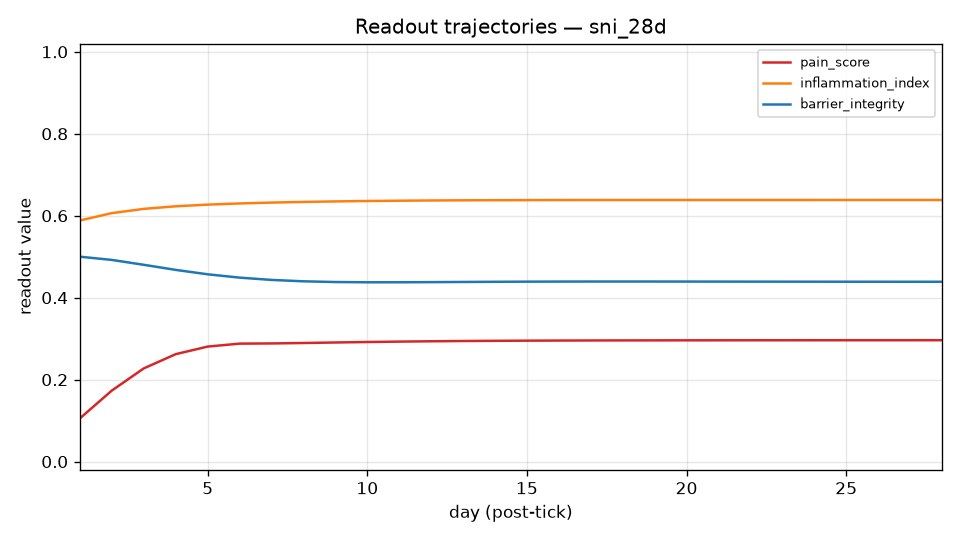

# CP Simulator Experiment Report

## 1. Run Overview

- run_dir: simulator/reports/runs/sni_28d
- scenario: sni_28d
- injury_model: SNI
- injury_tick: 0
- horizon_days: 28
- seed: 0
- engine_version: 0.1.0
- started_at_utc: 2026-08-25T21:15:24Z
- generated_at: 2026-08-25T21:16:12Z
- llm_calls_made: 0
- llm_calls_deferred: 0
- notes: SNI pilot scenario. Seeds are proximal injury drivers resolved against the real card set: microglial activation, TNF-alpha, ROS/oxidative stress, MMP-9, BDNF, HIF1-alpha. No DAMP card exists in the set; its canonical receptor TLR4 (tlr4_tlr4) is seeded as the DAMP-signaling proxy. Seed magnitude 0.92: orphan nodes contract toward baseline by a factor of ~0.637 per tick, so only seeds >= ~0.87 satisfy first_crossing with delta=0.15 and sustain=2 for two consecutive logged ticks. Sustained drives model tonic injury drivers after SNI: ongoing ectopic afferent firing and persistent glial activation keep microglia and TNF-a elevated through the whole horizon (value 0.9 from tick 0, no end tick = active while start <= tick < horizon).

## 2. Readout Trajectories

| day | pain_score | inflammation_index | barrier_integrity |
|---|---|---|---|
| 2 | 0.1734 | 0.6064 | 0.4921 |
| 4 | 0.2622 | 0.6230 | 0.4678 |
| 6 | 0.2879 | 0.6299 | 0.4489 |
| 8 | 0.2894 | 0.6337 | 0.4399 |
| 10 | 0.2918 | 0.6359 | 0.4376 |
| 12 | 0.2936 | 0.6372 | 0.4379 |
| 14 | 0.2947 | 0.6379 | 0.4388 |
| 16 | 0.2954 | 0.6382 | 0.4393 |
| 18 | 0.2957 | 0.6383 | 0.4394 |
| 20 | 0.2959 | 0.6383 | 0.4393 |
| 22 | 0.2960 | 0.6384 | 0.4391 |
| 24 | 0.2961 | 0.6384 | 0.4390 |
| 26 | 0.2961 | 0.6384 | 0.4389 |
| 28 | 0.2962 | 0.6384 | 0.4388 |

## 3. Key Entity Traces

### microbio_nad_augmentation — NAD⁺ Augmentation (NR/NMN) for Microglial Mitochondria in Pain (key: microglia)

state ▅▅▅▅▅▅▅▅▅▅▅▅▅▅▅▅▅▅▅▅▅▅▅▅▅▅▅▅
final 0.5000 vs baseline 0.5000 -> delta +0.0000

### GABA_apoptosis_TNF_alpha — TNF-α (Pro-Inflammatory Cytokine) (key: TNF)

state ▅▅▆▆▆▆▆▆▆▆▆▆▆▆▆▆▆▆▆▆▆▆▆▆▆▆▆▆
final 0.6918 vs baseline 0.5000 -> delta +0.1918

### BDNF_TrkB_proBDNF — proBDNF (key: BDNF)

state ▅▅▅▅▅▅▅▅▅▅▅▅▅▅▅▅▅▅▅▅▅▅▅▅▅▅▅▅
final 0.5000 vs baseline 0.5000 -> delta +0.0000

### BBB_CypA_MMP9_pathway — CypA-MMP-9 Pathway (key: MMP-9)

state ▅▅▅▅▅▆▆▆▆▆▆▆▆▆▆▆▆▆▆▆▆▆▆▆▆▆▆▆
final 0.6892 vs baseline 0.5000 -> delta +0.1892

### BDNF_TrkB_CLP257 — CLP257 (KCC2 Enhancer) (key: KCC2)

state ▁▁▁▁▁▁▁▁▁▁▁▁▁▁▁▁▁▁▁▁▁▁▁▁▁▁▁▁
final 0.0000 vs baseline 0.0000 -> delta +0.0000

### GABA_apoptosis_PNN_loss — Perineuronal Net (PNN) Loss and GABAergic Hyperactivity (key: perineuronal)

state ▅▅▅▆▆▆▆▆▆▆▆▆▆▆▆▆▆▆▆▆▆▆▆▆▆▆▆▆
final 0.7075 vs baseline 0.5000 -> delta +0.2075

### PV_interneurons_PV_interneurons — Parvalbumin (PV) Interneurons (key: parvalbumin)

state ▄▃▃▃▂▂▂▂▂▂▂▂▂▂▂▂▂▂▂▂▂▂▂▂▂▂▂▂
final 0.1375 vs baseline 0.5000 -> delta -0.3625

### shared_mechanical_allodynia — Mechanical Allodynia (key: allodynia)

state ▂▃▃▄▄▅▅▅▅▅▅▅▅▅▅▅▅▅▅▅▅▅▅▅▅▅▅▅
final 0.5896 vs baseline 0.0500 -> delta +0.5396

## 4. Emergent Events

Top single-tick state changes (pre-tick 0 reconstructed from card baselines and scenario initial_perturbations):

| rank | day | agent | label | delta | direction | propagation |
|---|---|---|---|---|---|---|
| 1 | 1 | GABA_apoptosis_ROS_oxidative_stress | Reactive Oxygen Species (ROS) and Oxidative Stress | -0.1554 | down |  |
| 2 | 1 | tlr4_tlr4 | TLR4 (Toll-like Receptor 4) | -0.1554 | down |  |
| 3 | 1 | RhoA_ROCK_ROCK | ROCK (ROCK1/ROCK2) | +0.1480 | up | cross-community |
| 4 | 1 | BDNF_TrkB_KCC2 | KCC2 (Potassium-Chloride Cotransporter) | -0.1111 | down | cross-community |
| 5 | 1 | shared_mechanical_allodynia | Mechanical Allodynia | +0.1111 | up | cross-community |
| 6 | 1 | SST_somatostatin_interneurons | Somatostatin (SST) Interneurons | +0.1111 | up | cross-community |
| 7 | 1 | vegf_VEGFA | Vascular Endothelial Growth Factor A (VEGFA) | +0.1111 | up | cross-community |
| 8 | 2 | vegf_VEGFA | Vascular Endothelial Growth Factor A (VEGFA) | +0.1072 | up | cross-community |
| 9 | 2 | shared_mechanical_allodynia | Mechanical Allodynia | +0.1066 | up | cross-community |
| 10 | 1 | BDNF_TrkB_rationale_dual_roles | Rationale: BDNF has both pro-nociceptive and anti-nociceptive roles | +0.1011 | up | cross-community |

## 5. Perturbation & Drug Accounting

### initial_perturbations (7)

- GABA_apoptosis_ROS_oxidative_stress -> value 0.9200
- PNN_ECM_MMP9 -> value 0.9200
- TNF_TNF_alpha -> value 0.9200
- assaying_molecularly_structural_plasticity_BDNF -> value 0.9200
- hif1a_HIF1alpha -> value 0.9200
- shared_microglia -> value 0.9200
- tlr4_tlr4 -> value 0.9200

### sustained_drives (2)
- TNF_TNF_alpha: value 0.9000, window [0, 28)
- observed effect @ TNF_TNF_alpha: mean-in 0.9676 vs mean-out n/a
- shared_microglia: value 0.9000, window [0, 28)
- observed effect @ shared_microglia: mean-in 0.9555 vs mean-out n/a

### drug_arms (0)
- none

## 6. Anomaly Flags

Rule-based flags:

- PINNED: Fumagillin (Ang-2 Inhibitor) (AngPt_fumagillin) at 0.0000 for 100.00% of ticks (> 20%)
- PINNED: CLP257 (KCC2 Enhancer) (BDNF_TrkB_CLP257) at 0.0000 for 100.00% of ticks (> 20%)
- PINNED: Rapamycin (mTOR Inhibitor / Autophagy Enhancer) (GABA_apoptosis_Rapamycin) at 0.0000 for 100.00% of ticks (> 20%)
- PINNED: 846-861PE (NgR1 Antagonist Peptide) (NogoA_NgR1_846_861PE) at 0.0000 for 100.00% of ticks (> 20%)
- PINNED: SB-3CT (MMP Inhibitor) (PNN_ECM_SB3CT) at 0.0000 for 100.00% of ticks (> 20%)
- PINNED: TIMP-1 (Endogenous MMP Inhibitor) (PNN_ECM_TIMP1) at 0.0000 for 100.00% of ticks (> 20%)
- PINNED: C3 Exoenzyme (RhoA Inhibitor) (RhoA_ROCK_C3_exoenzyme) at 0.0000 for 100.00% of ticks (> 20%)
- PINNED: Y-27632 (ROCK Inhibitor) (RhoA_ROCK_Y27632) at 0.0000 for 100.00% of ticks (> 20%)
- PINNED: Fasudil (ROCK Inhibitor) (RhoA_ROCK_fasudil) at 0.0000 for 100.00% of ticks (> 20%)
- PINNED: Simvastatin (RhoA Inhibitor) (RhoA_ROCK_simvastatin) at 0.0000 for 100.00% of ticks (> 20%)
- PINNED: XPro1595 (solTNF/TNFR1 Blocker) (TNF_XPro1595) at 0.0000 for 100.00% of ticks (> 20%)
- PINNED: Bcl-xL (Dual-Functional Apoptosis/Autophagy Inhibitor) (autophagy-apoptosis_inhibition_Bcl_xL) at 0.0000 for 100.00% of ticks (> 20%)
- PINNED: PX-478 (HIF1α Inhibitor) (hif1a_PX478) at 0.0000 for 100.00% of ticks (> 20%)
- PINNED: YC-1 (HIF1α Inhibitor) (hif1a_YC1) at 0.0000 for 100.00% of ticks (> 20%)
- PINNED: MCC950 (NLRP3 Inhibitor) (insights_nlrp3_mcc950) at 0.0000 for 100.00% of ticks (> 20%)
- PINNED: Cofilin-Modulating Peptides (Slingshot Phosphatase Inhibitor) (karilin7_CofilinModulatingPeptides) at 0.0000 for 100.00% of ticks (> 20%)
- PINNED: LIMK Inhibitors (Therapeutic Strategy) (karilin7_LIMK_Inhibitors) at 0.0000 for 100.00% of ticks (> 20%)
- PINNED: NSC23766 (Rac1 Inhibitor, ACC Microinjection) (karilin7_NSC23766) at 0.0000 for 21.43% of ticks (> 20%)
- PINNED: Urolithin A (Mitophagy Enhancer for Pain) (microbio_urolithin_a) at 0.0000 for 100.00% of ticks (> 20%)
- PINNED: Selective PPARγ Modulators (SPPARγMs) (ppary_spppargms) at 0.0000 for 100.00% of ticks (> 20%)

Unresolved key-label warnings:
- none

## 7. Reproducibility

- manifest.json sha256 (A): 0fd01a833558902f5f6f26a799ec7f2bebf30310f655e0a32daf67622efe7ae2
- tick_log.jsonl sha256 (A): 74e24e08a18dbf4988b19bcd0f089430d7327218c7d741506a99a6a65fa9fdfe
- states.csv sha256 (A): 0e7ecf32e48eaf45b617503041b86dc3c9702704ab63d2a6e4a9c1bfb6d6e748
- manifest.json sha256 (B): 03ef16fe6c4587a1bde383591ae9e30b02ed069f1c30dfef50d31ca8f771601f
- tick_log.jsonl sha256 (B): 632618059ef498eba3511fa564bc324cd617c280de2ad4c05db07cc37a3ba5de
- states.csv sha256 (B): 03f971dc0202108d3c22031aaf3eea192ba7fbe9a2ba06824393947ac1863f92
- card_set_hash: 6b44c2de7e76c8c59202fb72992f91883465a8946bdc4c6aa1c2519555df2a1b (cards manifest hash)
- determinism: rules-only engine runs are byte-reproducible (identical manifest.json / tick_log.jsonl / states.csv); the generation timestamp above and the embedded PNG plot are excluded from determinism claims (PNG bytes are not guaranteed reproducible).
- command: python3 -m simulator.reports.generate_report --run simulator/reports/runs/sni_28d --compare simulator/reports/runs/SNI_28d_CLP257 --out simulator/reports/report_SNI_vs_CLP257.md

## 8. Comparison A vs B (sni_28d vs sni_28d_clp257)

Common window: ticks 1..28 (28 ticks)

| readout | sni_28d (A) | bar | sni_28d_clp257 (B) | bar | delta (B-A) |
|---|---|---|---|---|---|
| pain_score | 0.2791 | [###.......] | 0.2390 | [##........] | -0.0402 |
| inflammation_index | 0.6326 | [######....] | 0.6326 | [######....] | +0.0000 |
| barrier_integrity | 0.4466 | [####......] | 0.4466 | [####......] | +0.0000 |
