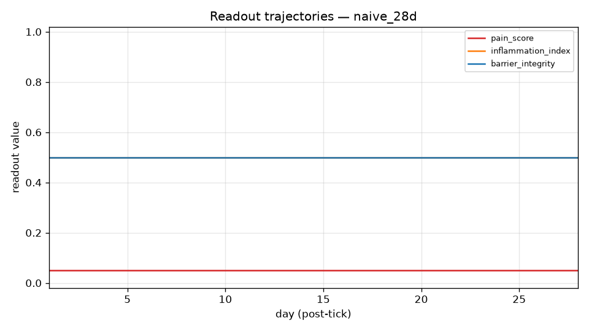

# CP Simulator Experiment Report

## 1. Run Overview

- run_dir: simulator/reports/runs/naive_28d
- scenario: naive_28d
- injury_model: naive
- injury_tick: n/a
- horizon_days: 28
- seed: 0
- engine_version: 0.1.0
- started_at_utc: 2026-08-26T13:26:38Z
- generated_at: 2026-08-26T13:29:06Z
- llm_calls_made: 0
- llm_calls_deferred: 0
- notes: Naive control arm for the SNI pilot: no injury tick, no perturbations, no drug arms. All agents start at their card baselines.

## 2. Readout Trajectories

| day | pain_score | inflammation_index | barrier_integrity |
|---|---|---|---|
| 2 | 0.0500 | 0.5000 | 0.5000 |
| 4 | 0.0500 | 0.5000 | 0.5000 |
| 6 | 0.0500 | 0.5000 | 0.5000 |
| 8 | 0.0500 | 0.5000 | 0.5000 |
| 10 | 0.0500 | 0.5000 | 0.5000 |
| 12 | 0.0500 | 0.5000 | 0.5000 |
| 14 | 0.0500 | 0.5000 | 0.5000 |
| 16 | 0.0500 | 0.5000 | 0.5000 |
| 18 | 0.0500 | 0.5000 | 0.5000 |
| 20 | 0.0500 | 0.5000 | 0.5000 |
| 22 | 0.0500 | 0.5000 | 0.5000 |
| 24 | 0.0500 | 0.5000 | 0.5000 |
| 26 | 0.0500 | 0.5000 | 0.5000 |
| 28 | 0.0500 | 0.5000 | 0.5000 |

## 3. Key Entity Traces

### CSF1-CSF1R_SpinalMicroglia — Spinal Microglia (Activated) (key: microglia)

state ▅▅▅▅▅▅▅▅▅▅▅▅▅▅▅▅▅▅▅▅▅▅▅▅▅▅▅▅
final 0.5000 vs baseline 0.5000 -> delta +0.0000

### GABA_apoptosis_TNF_alpha — TNF-α (Pro-Inflammatory Cytokine) (key: TNF)

state ▅▅▅▅▅▅▅▅▅▅▅▅▅▅▅▅▅▅▅▅▅▅▅▅▅▅▅▅
final 0.5000 vs baseline 0.5000 -> delta +0.0000

### BDNF_TrkB_proBDNF — proBDNF (key: BDNF)

state ▅▅▅▅▅▅▅▅▅▅▅▅▅▅▅▅▅▅▅▅▅▅▅▅▅▅▅▅
final 0.5000 vs baseline 0.5000 -> delta +0.0000

### BBB_CypA_MMP9_pathway — CypA-MMP-9 Pathway (key: MMP-9)

state ▅▅▅▅▅▅▅▅▅▅▅▅▅▅▅▅▅▅▅▅▅▅▅▅▅▅▅▅
final 0.5000 vs baseline 0.5000 -> delta +0.0000

### BDNF_TrkB_CLP257 — CLP257 (KCC2 Enhancer) (key: KCC2)

state ▁▁▁▁▁▁▁▁▁▁▁▁▁▁▁▁▁▁▁▁▁▁▁▁▁▁▁▁
final 0.0000 vs baseline 0.0000 -> delta +0.0000

### GABA_apoptosis_PNN_loss — Perineuronal Net (PNN) Loss and GABAergic Hyperactivity (key: perineuronal)

state ▅▅▅▅▅▅▅▅▅▅▅▅▅▅▅▅▅▅▅▅▅▅▅▅▅▅▅▅
final 0.5000 vs baseline 0.5000 -> delta +0.0000

### PV_interneurons_PV_interneurons — Parvalbumin (PV) Interneurons (key: parvalbumin)

state ▅▅▅▅▅▅▅▅▅▅▅▅▅▅▅▅▅▅▅▅▅▅▅▅▅▅▅▅
final 0.5000 vs baseline 0.5000 -> delta +0.0000

### shared_mechanical_allodynia — Mechanical Allodynia (key: allodynia)

state ▁▁▁▁▁▁▁▁▁▁▁▁▁▁▁▁▁▁▁▁▁▁▁▁▁▁▁▁
final 0.0500 vs baseline 0.0500 -> delta +0.0000

## 4. Emergent Events

Top single-tick state changes (pre-tick 0 reconstructed from card baselines and scenario initial_perturbations):

| rank | day | agent | label | delta | direction | propagation |
|---|---|---|---|---|---|---|
| n/a | n/a | n/a | (no changes) | n/a | n/a | |

## 5. Perturbation & Drug Accounting

### initial_perturbations (0)

- none

### sustained_drives (0)
- none

### drug_arms (0)
- none

## 6. Anomaly Flags

Rule-based flags:

- PINNED: Fumagillin (Ang-2 Inhibitor) (AngPt_fumagillin) at 0.0000 for 100.00% of ticks (> 20%)
- PINNED: CLP257 (KCC2 Enhancer) (BDNF_TrkB_CLP257) at 0.0000 for 100.00% of ticks (> 20%)
- PINNED: Rapamycin (mTOR Inhibitor / Autophagy Enhancer) (GABA_apoptosis_Rapamycin) at 0.0000 for 100.00% of ticks (> 20%)
- PINNED: mTORC1 (Mammalian Target of Rapamycin Complex 1) (GABA_apoptosis_mTORC1) at 0.0000 for 100.00% of ticks (> 20%)
- PINNED: 846-861PE (NgR1 Antagonist Peptide) (NogoA_NgR1_846_861PE) at 0.0000 for 100.00% of ticks (> 20%)
- PINNED: SB-3CT (MMP Inhibitor) (PNN_ECM_SB3CT) at 0.0000 for 100.00% of ticks (> 20%)
- PINNED: TIMP-1 (Endogenous MMP Inhibitor) (PNN_ECM_TIMP1) at 0.0000 for 100.00% of ticks (> 20%)
- PINNED: C3 Exoenzyme (RhoA Inhibitor) (RhoA_ROCK_C3_exoenzyme) at 0.0000 for 100.00% of ticks (> 20%)
- PINNED: Y-27632 (ROCK Inhibitor) (RhoA_ROCK_Y27632) at 0.0000 for 100.00% of ticks (> 20%)
- PINNED: Fasudil (ROCK Inhibitor) (RhoA_ROCK_fasudil) at 0.0000 for 100.00% of ticks (> 20%)
- PINNED: Simvastatin (RhoA Inhibitor) (RhoA_ROCK_simvastatin) at 0.0000 for 100.00% of ticks (> 20%)
- PINNED: XPro1595 (solTNF/TNFR1 Blocker) (TNF_XPro1595) at 0.0000 for 100.00% of ticks (> 20%)
- PINNED: Bcl-xL (Dual-Functional Apoptosis/Autophagy Inhibitor) (autophagy-apoptosis_inhibition_Bcl_xL) at 0.0000 for 100.00% of ticks (> 20%)
- PINNED: Ethosuximide (T-type channel blocker, repurposing) (cav32_ethosuximide) at 0.0000 for 100.00% of ticks (> 20%)
- PINNED: Z944 (selective T-type blocker, Phase II) (cav32_z944) at 0.0000 for 100.00% of ticks (> 20%)
- PINNED: AMG487 (CXCR3 antagonist) (ccl21_amg487) at 0.0000 for 100.00% of ticks (> 20%)
- PINNED: TAT-Gap19 (Cx43 hemichannel blocker) (connexin43_tat_gap19) at 0.0000 for 100.00% of ticks (> 20%)
- PINNED: CX3CR1 Antagonists (analgesics) (cx3cl1_cx3cr1_amd3100_analog) at 0.0000 for 100.00% of ticks (> 20%)
- PINNED: AMD3100 / Plerixafor (CXCR4 antagonist, FDA-approved) (cxcl12_cxcr4_amd3100) at 0.0000 for 100.00% of ticks (> 20%)
- PINNED: Atrasentan / ABT-627 (ETA-selective antagonist) (endothelin_atrasentan) at 0.0000 for 100.00% of ticks (> 20%)
- PINNED: Bosentan (dual ETA/ETB antagonist, PAH-approved) (endothelin_bosentan) at 0.0000 for 100.00% of ticks (> 20%)
- PINNED: ACY-1083 / Tubastatin A (HDAC6 inhibitors) (hdac_acy1083) at 0.0000 for 100.00% of ticks (> 20%)
- PINNED: RGFP966 (HDAC3-selective inhibitor) (hdac_rgfp966) at 0.0000 for 100.00% of ticks (> 20%)
- PINNED: Vorinostat/SAHA (pan-HDAC inhibitor) (hdac_vorinostat) at 0.0000 for 100.00% of ticks (> 20%)
- PINNED: PX-478 (HIF1α Inhibitor) (hif1a_PX478) at 0.0000 for 100.00% of ticks (> 20%)
- PINNED: YC-1 (HIF1α Inhibitor) (hif1a_YC1) at 0.0000 for 100.00% of ticks (> 20%)
- PINNED: 1400W (selective iNOS inhibitor) (inos_1400w) at 0.0000 for 100.00% of ticks (> 20%)
- PINNED: MCC950 (NLRP3 Inhibitor) (insights_nlrp3_mcc950) at 0.0000 for 100.00% of ticks (> 20%)
- PINNED: Baricitinib (JAK1/2 Inhibitor, RA-Approved) (jakstat_baricitinib) at 0.0000 for 100.00% of ticks (> 20%)
- PINNED: Ruxolitinib (JAK1/2 Inhibitor, FDA-Approved) (jakstat_ruxolitinib) at 0.0000 for 100.00% of ticks (> 20%)
- PINNED: Cofilin-Modulating Peptides (Slingshot Phosphatase Inhibitor) (karilin7_CofilinModulatingPeptides) at 0.0000 for 100.00% of ticks (> 20%)
- PINNED: Tacrolimus/FK506 (Calcineurin Inhibitor) (karilin7_FK506) at 0.0000 for 100.00% of ticks (> 20%)
- PINNED: LIMK Inhibitors (Therapeutic Strategy) (karilin7_LIMK_Inhibitors) at 0.0000 for 100.00% of ticks (> 20%)
- PINNED: NSC23766 (Rac1 Inhibitor, ACC Microinjection) (karilin7_NSC23766) at 0.0000 for 100.00% of ticks (> 20%)
- PINNED: ARN23746 (next-gen KCC2 activator) (kcc2enhancers_arn23746) at 0.0000 for 100.00% of ticks (> 20%)
- PINNED: Urolithin A (Mitophagy Enhancer for Pain) (microbio_urolithin_a) at 0.0000 for 100.00% of ticks (> 20%)
- PINNED: MCC950 / CRID3 (NLRP3 inhibitor) (nlrp3_mcc950) at 0.0000 for 100.00% of ticks (> 20%)
- PINNED: DAPT (γ-secretase inhibitor) (notch_dapt) at 0.0000 for 100.00% of ticks (> 20%)
- PINNED: Rapamycin / Sirolimus (mTORC1 inhibitor) (pi3k_akt_mtor_rapamycin) at 0.0000 for 100.00% of ticks (> 20%)
- PINNED: Selective PPARγ Modulators (SPPARγMs) (ppary_spppargms) at 0.0000 for 100.00% of ticks (> 20%)
- PINNED: KCC2 Enhancement Pillar (CLP257/AAV-KCC2) (proposal_chronic_pain_treatment_Kcc2Enhancement) at 0.0000 for 100.00% of ticks (> 20%)
- PINNED: ROCK Inhibition Pillar (Fasudil/AS1892802) (proposal_chronic_pain_treatment_RockInhibition) at 0.0000 for 100.00% of ticks (> 20%)
- PINNED: TNFR1-Selective TNF Blockade Pillar (XPro1595) (proposal_chronic_pain_treatment_Tnfr1SelectiveBlockade) at 0.0000 for 100.00% of ticks (> 20%)
- PINNED: Azeliragon (TTP488, oral RAGE antagonist) (rage_azeliragon) at 0.0000 for 100.00% of ticks (> 20%)
- PINNED: FPS-ZM1 (brain-penetrant RAGE antagonist) (rage_fps_zm1) at 0.0000 for 100.00% of ticks (> 20%)
- PINNED: Aprepitant (NK1 antagonist, clinical failures) (substance_p_nk1_aprepitant) at 0.0000 for 100.00% of ticks (> 20%)

Unresolved key-label warnings:
- none

## 7. Reproducibility

- manifest.json sha256: d1d4a973a3fd4c8a4ac746e0f7c10600459c555941bb739f307772393583fcc0
- tick_log.jsonl sha256: 87004f2ad00aeb5d106c6a888e2f04639b2f4eecf4ee2eeba692f53bfca3aeea
- states.csv sha256: 0fe2b03eb4362818ba318ea13bec69854b2885dafaf5fcced28d21bcc5fd6f0c
- card_set_hash: a401244b561d1172edf5890609d3ac5f038a3837083ffd7c35ec7763613cee6c (cards manifest hash)
- determinism: rules-only engine runs are byte-reproducible (identical manifest.json / tick_log.jsonl / states.csv); the generation timestamp above and the embedded PNG plot are excluded from determinism claims (PNG bytes are not guaranteed reproducible).
- command: python3 -m simulator.reports.generate_report --run simulator/reports/runs/naive_28d --out simulator/reports/report_naive_28d.md --plots-dir simulator/reports/plots
